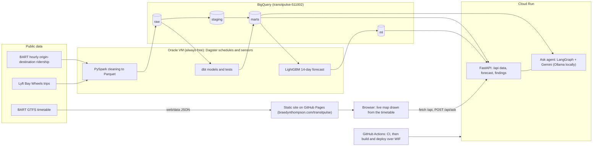
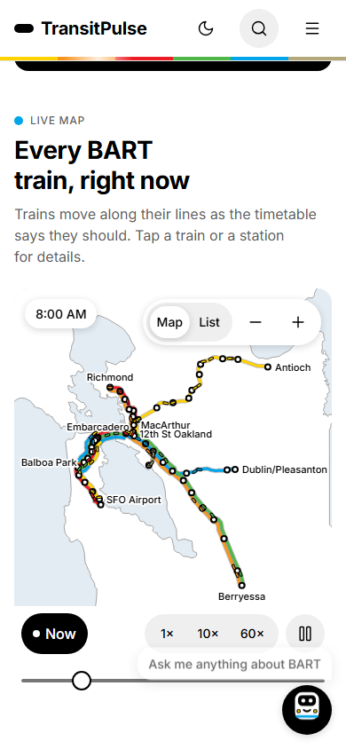
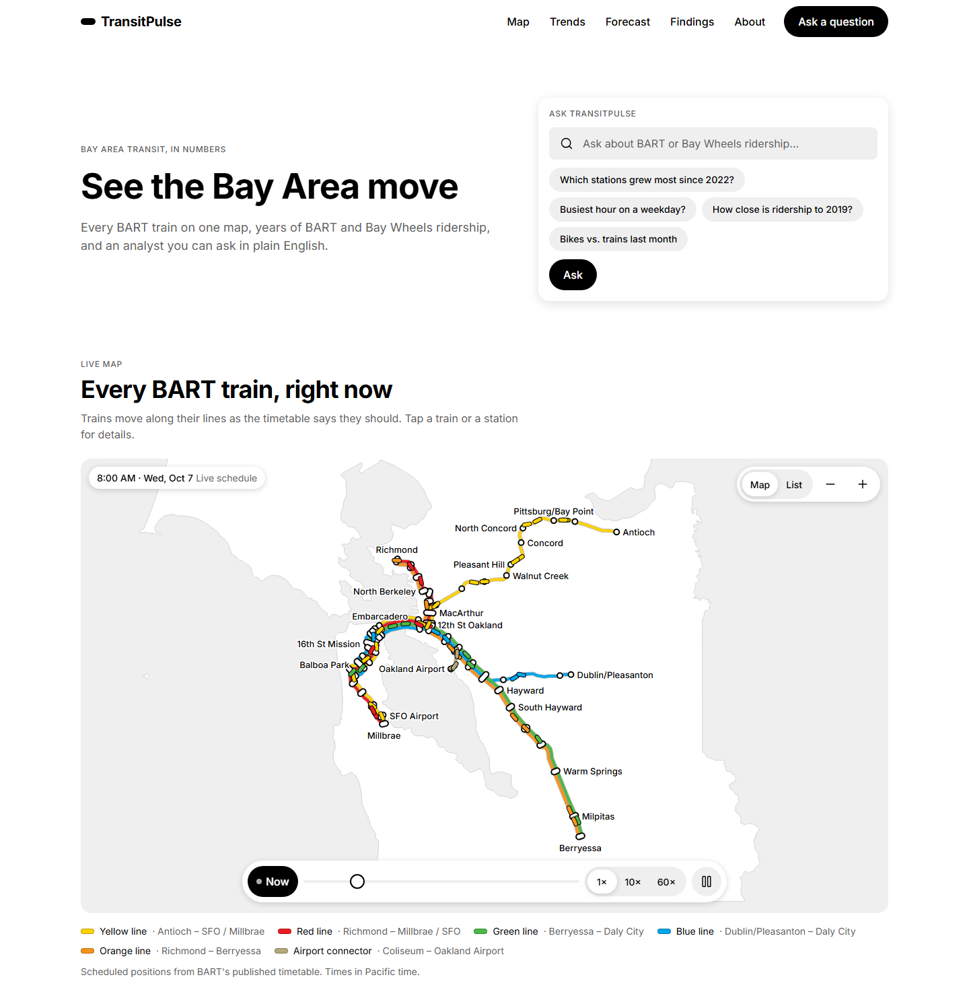

# TransitPulse

A Bay Area transit analytics platform: BART and Bay Wheels ridership pipelines (Dagster + PySpark + dbt on BigQuery),
station forecasts, a causal study of the eBART extension, an AI analyst agent that answers questions with SQL, and a
responsive website with a live map of scheduled BART trains.

> **Status (2026-10-14):** live. The site is at **[braedynthompson.com/transitpulse](https://braedynthompson.com/transitpulse/)**,
> the API on Cloud Run, and the pipeline runs itself on an Oracle VM. What's left is under [Left to do](#left-to-do);
> the owner's steps, in order, are in [`docs/OWNER_STEPS.md`](docs/OWNER_STEPS.md).
> How each part works today: [`docs/CURRENT_STATE.md`](docs/CURRENT_STATE.md).

## Progress
| Milestone | Status |
|---|---|
| M0 setup (GCP, Terraform, repo) | ✅ Done |
| M1 data platform (Dagster, PySpark, dbt, BigQuery) | ✅ Done. Runs itself on the VM: BART is checked every 6 hours and reloaded when it changes, then dbt rebuilds |
| M2 KPIs + BI | 🟡 KPIs done (`mart_kpis_daily`, on the site). Build guide, DAX and a check week ready ([`bi/README.md`](bi/README.md)); the Looker Studio and Power BI reports need the owner's accounts |
| M3 forecasting (LightGBM) | ✅ Done. Beats the baseline; retrains every Monday |
| M4 eBART causal study | ✅ Done. Live in the site's Findings band |
| M5 AI analyst agent + eval | ✅ Done. A/B test: 5 retrieved example queries lift llama3.1:8b from 27% to 50% execution accuracy (McNemar p = 0.004), so they ship ([`docs/AB_TEST.md`](docs/AB_TEST.md)). The agent is off on the live site until the owner adds a Gemini key |
| M6 QLoRA fine-tune | ⬜ Deferred to its own build loop (a decision in [`docs/OWNER_STEPS.md`](docs/OWNER_STEPS.md) §13); the A/B harness is ready for arm C |
| M7 ship | 🟡 Live, and every push to `main` deploys itself. Architecture diagram, screenshots and `make up` done. dbt/Terraform checks in CI wait for the owner's CI identity decisions |
| F1–F7 website | 🟡 Built and live (map, trends, forecast explorer, Findings, Ask with history and Copy SQL). Style guide, axe contrast tests, Lighthouse 98/100/100 and the Open Graph image are done; real-device checks left |

## Architecture



| Phone (390 px) | Desktop (1440 px) |
|---|---|
|  |  |

Both are made by `uv run python tasks.py screenshots` (Playwright, Wednesday 8:00 AM Pacific, local warehouse), which
also writes the Open Graph image `web/img/og.png`. Every component and token is on the
[style guide](web/styleguide.html) page (`/styleguide.html` on the site).

## Results
| What | Number |
|---|---|
| BART ridership in BigQuery | 67,770,440 hourly origin-destination rows, 2018–2025, 4.2 GB |
| Bay Wheels trips | 25,989,969 trips, 2018 → Sep 2026 |
| Forecast (14-day, per station, 6 walk-forward folds) | MAE **283.1** vs **548.5** for the seasonal-naive baseline; improvement 265.4 entries/day, 95% CI [199.6, 339.9]. The p10–p90 band holds 73% of days (nominal 80%), so the site calls it the "model range" |
| Ask agent A/B (llama3.1:8b, local) | Execution accuracy **0.27** (18/66 gold-SQL questions) without examples → **0.50** (33/66) with 5 retrieved example queries: +22.7 points, 95% CI [+9.1, +36.4], exact McNemar p = 0.004 (b = 5, c = 20). Refusal accuracy 1.0 (10 off-topic questions) in both; p50 1.7 s. [`docs/AB_TEST.md`](docs/AB_TEST.md) |
| eBART study | See [Findings](#findings-the-ebart-causal-study) below |
| Cloud Run | Cold start about **4.4 s** to the first byte; warm requests 0.09–0.17 s (measured 2026-10-15) |
| GCP cost | $0 expected (every service inside its free tier); the month-end bill is to be confirmed ([`docs/OWNER_STEPS.md`](docs/OWNER_STEPS.md) §12) |
| Lighthouse (mobile, local server, median of 3) | Performance **98**, accessibility **100**, best practices **100**; LCP 2.3 s, CLS 0 (`tasks.py lighthouse --runs 3 --assert`, 2026-10-14). axe finds 0 contrast violations at 390 and 1440 px |

## Run locally

Requires Python 3.12 and [uv](https://docs.astral.sh/uv/). On Windows there is no `make`; use `uv run python tasks.py <task>`.

```sh
uv sync                                  # install
uv run python tasks.py api               # site + API on http://localhost:8000 (map data is committed)
uv run python tasks.py test              # Python + browser-maths unit tests
npm ci && npx playwright install chromium && npx playwright test   # browser tests (incl. axe contrast)
uv run python tasks.py lighthouse --runs 3 --assert                 # Lighthouse mobile gate, local only
uv run python tasks.py screenshots                                  # README screenshots + Open Graph image
```

Data pipeline, fully local (no cloud account needed; Spark runs in Docker on Windows):

```sh
uv sync --group pipeline --group dbt --group spark
uv run python tasks.py dagster           # Dagster UI on http://localhost:3000: materialize assets / backfill years
# or step by step:
uv run python tasks.py web-data          # GTFS -> web/data/*.json
uv run python tasks.py stations          # GTFS -> station list for the SCD2 snapshot
uv run python tasks.py spark             # data/raw/bart_od/*.csv.gz -> partitioned Parquet
uv run python tasks.py baywheels         # Bay Wheels 2019 + 2025: download (~250 MB) + clean -> Parquet
uv run python tasks.py dbt               # dbt build on DuckDB (data/transitpulse.duckdb)
uv run python tasks.py forecast          # 14-day station forecast (LightGBM + calibrated band) -> marts.forecast_station_daily
uv run python tasks.py eval --llm ollama --arm B   # score the Ask agent on eval/questions.yaml (needs Ollama + llama3.1:8b)
uv run --group agent python -m eval.ab             # A/B statistics over the committed arm A and arm B summaries
```

**`make up`** (or `uv run python tasks.py up`) starts the site, the API and the Ask agent on an Ollama container
with Docker Compose ([`docker-compose.yml`](docker-compose.yml)) at http://localhost:8000. The first run downloads the
Ollama image (9.4 GB on disk) and the model (`llama3.1:8b`, about 4.9 GB; `TP_OLLAMA_MODEL=<name>` picks another,
`TP_OLLAMA_DATA=<dir>` reuses a host model folder). It reads `data/transitpulse.duckdb` read-only when it exists;
from a fresh clone the data endpoints answer 503 and data questions end with a clean "not connected" error. CPU by
default; see the file for the GPU option.

The Ask card's agent is off by default (the site says it isn't connected). To try it locally without Docker:
`TP_AGENT_ENABLED=true TP_AGENT_LLM=ollama uv run --group agent python tasks.py api` (`TP_AGENT_LLM=fake` needs no
model and answers a few canned queries).

With `data/transitpulse.duckdb` built, `uv run python tasks.py api` serves real numbers on the site
(it sets `TP_WAREHOUSE=duckdb`; set `TP_WAREHOUSE=bigquery` + `TP_GCP_PROJECT` to read BigQuery instead).
Checks on the real local data: `uv run --group dbt --group ml --group agent pytest -m localdata tests/local`.

The production pipeline runs on the Oracle VM ([`docs/ORACLE_VM.md`](docs/ORACLE_VM.md)), and every automation
starts on by default:
- BART is checked every 6 hours and reloaded when its file changes; dbt rebuilds after every ingest.
- Bay Wheels reloads on the 7th of each month.
- A full model rebuild runs on the 6th.
- The forecast retrains every Monday.

After changing pipeline code, update the VM with `sudo bash /opt/transitpulse/deploy/oracle/bootstrap.sh`. Wait for
running jobs to finish first: the restart kills them.

## Findings: the eBART causal study

Did the 2018 eBART extension to Antioch bring new riders, or just move them between stations? This is a
pre-registered difference-in-differences study against 34 BART stations far from the line, with 95% placebo
intervals. It uses weekly data from 2018 to Feb 2020 and monthly data from 2016. The write-up is
[`docs/FINDINGS.md`](docs/FINDINGS.md), served on the site from `GET /api/findings`.

| Estimate | Effect | 95% placebo interval |
|---|---|---|
| Whole line, Concord → Antioch (incl. new stations) | **+4.2%** (about 500 entries a day) | +1.6% to +7.1% |
| Pittsburg/Bay Point, North Concord, Concord | **−23.9%** | −25.8% to −21.8% |
| Rest of the yellow line (spillover check) | +0.5% | −1.7% to +3.0% |
| Whole line, net of the pre-opening trend (post-hoc, not pre-registered) | +1.0% | −2.4% to +4.2% |

- **Verdict (pre-registered rule): new.** Most riders at the new stations moved from the old ones; the line as a
  whole is consistent with a small net gain, not a firm finding.
- **Caveats.** The gain fades after the first year. The longer monthly series also shows the corridor already
  rising against the controls before the opening. Carrying that trend forward (a post-hoc check, decided after the
  results, so it does not change the verdict) leaves about +1% with an interval that contains 0: the +4.2% is not
  distinguishable from trend. `uv run --group ml python -m analysis.causal.trend_adjusted` reproduces it.

```sh
uv run python tasks.py causal            # recompute api/data/findings.json + docs/img/ plots from the committed CSVs
```

## Deploy (Cloud Run) and load test

The site and API ship as one container ([`Dockerfile`](Dockerfile): multi-stage, non-root, **119 MB compressed**, so
the 3 images Artifact Registry keeps fit its 0.5 GB free tier). Terraform for the service and for GitHub's keyless
Workload Identity Federation is in [`infra/terraform/`](infra/terraform/). [`deploy.yml`](.github/workflows/deploy.yml)
builds, pushes and deploys on every push to `main`. All of it is applied and switched on (`DEPLOY_ENABLED=true`);
the steps are in [`docs/CLOUD_RUN.md`](docs/CLOUD_RUN.md).

```sh
uv run python tasks.py image             # docker build + container smoke tests (tests/deploy)
uv run python tasks.py load              # Locust, 1/10/25 users, on a fixture warehouse with the fake LLM
```

Local load test (this PC, a 3-station DuckDB fixture, fake LLM, 20 s per step, 0 failures). These are not Cloud Run
numbers:

| Users | Requests/s | `/api/forecast` p50 / p95 / p99 | `/api/kpis` p50 / p95 / p99 | `/api/ask` p50 / p95 / p99 |
|---|---|---|---|---|
| 1 | 1.2 | 54 / 62 / 62 ms | 5 / 540 / 540 ms | 42 / 870 / 870 ms |
| 10 | 11.8 | 4 / 8 / 17 ms | 4 / 11 / 17 ms | 43 / 58 / 58 ms |
| 25 | 29.7 | 5 / 14 / 30 ms | 4 / 22 / 29 ms | 37 / 140 / 140 ms |

The slow 1-user p95s are the first requests, before the API's cache and the agent graph are warm. The container
starts in about 1.5 s locally and uses about 76 MiB of its 512 MiB. On Cloud Run, the first request after scaling to
zero takes about 4.4 s; warm requests take 0.09–0.17 s. A Locust run against Cloud Run hasn't been done yet.

## Limitations
The agent's 50% is llama3.1:8b on its own eval set with near-twin examples in the pool; the live agent runs
Gemini (`gemini-3.5-flash-lite`, the model the free tier allows enough requests for), unmeasured on the full set. The eBART "new riders" verdict rests on 3 treated stations and is not distinguishable from
trend once the pre-opening drift is removed. The forecast band under-covers (73% for a nominal 80%). The map shows
the timetable, not live positions. The full list is in
[`docs/CURRENT_STATE.md` §7](docs/CURRENT_STATE.md#7-known-limitations-current-behaviour).

## Docs
| File | What it is |
|---|---|
| [`docs/TRANSITPULSE_PLAN.md`](docs/TRANSITPULSE_PLAN.md) | Goals, stack and the skills this project demonstrates |
| [`docs/IMPLEMENTATION_PLAN.md`](docs/IMPLEMENTATION_PLAN.md) | Ordered build checklist (M0–M7, F1–F7) |
| [`docs/DESIGN.md`](docs/DESIGN.md) | Design system (frozen v1.0) |
| [`docs/CURRENT_STATE.md`](docs/CURRENT_STATE.md) | How the application works right now |
| [`docs/DEVLOG.md`](docs/DEVLOG.md) | Running log of changes and decisions |
| [`docs/SKILLS_MAP.md`](docs/SKILLS_MAP.md) | Where each skill is implemented, and how it works |
| [`docs/METRICS.md`](docs/METRICS.md) | KPI definitions, the website tile windows, bikes vs trains, forecast coverage, agent eval, causal estimates |
| [`docs/FINDINGS.md`](docs/FINDINGS.md) | The eBART causal study: pre-registration, design, results, limitations |
| [`docs/AB_TEST.md`](docs/AB_TEST.md) | The M5 A/B test of the Ask agent: power analysis, pre-registered design, results, decision |
| [`bi/README.md`](bi/README.md) | Looker Studio and Power BI build guide, DAX measures and the check week |
| [`docs/OWNER_STEPS.md`](docs/OWNER_STEPS.md) | The owner's remaining steps, in order: commit and push, re-export, the live agent, BI, CI identity, devices, bill, M6 |
| [`docs/ORACLE_VM.md`](docs/ORACLE_VM.md) | Runbook: Dagster on the Oracle VM (systemd) |
| [`docs/CLOUD_RUN.md`](docs/CLOUD_RUN.md) | Runbook: the site + API on Cloud Run (Terraform, WIF, deploy workflow, costs) |

## Data sources and licences
| Data | Source | Licence / terms |
|---|---|---|
| BART GTFS schedule | bart.gov → Developers → GTFS | BART developer license agreement (attribution: "Data provided by BART") |
| BART hourly origin-destination ridership | bart.gov → About → Reports → Ridership | Public BART data; same developer terms |
| BART monthly ridership reports (2016–2020, eBART study) | bart.gov → About → Reports → Ridership (`ridership_YYYY.zip`) | Public BART data; same developer terms (derived station-month averages committed in `analysis/causal/data/`) |
| Bay Wheels trip data | [Lyft Bay Wheels System Data](https://www.lyft.com/bikes/bay-wheels/system-data) (bucket `s3.amazonaws.com/baywheels-data`) | [Bay Wheels Data License Agreement](https://baywheels-assets.s3.amazonaws.com/data-license-agreement.html) (verified 2026-10-08) |
| Bay Area coastline | US Census Bureau cartographic boundary files | Public domain |

BART's terms were checked on 2026-10-14. They allow the derived data with attribution, and "Data provided by BART"
appears in `analysis/causal/data/README.md`, `docs/FINDINGS.md`, the Findings band and the site footer.

## Left to do

**Code (no accounts needed)**
1. **M6 QLoRA fine-tune** (deferred to its own build loop). 1–3K question→SQL pairs, QLoRA of Qwen2.5-Coder-1.5B on
   the RTX 4060, GGUF → Ollama, then scored as arm C in `docs/AB_TEST.md`. Starting it is owner decision 13.
2. **Cut for v1** (recorded in [`docs/IMPLEMENTATION_PLAN.md`](docs/IMPLEMENTATION_PLAN.md)): the hour × weekday
   heatmap (it needs a new mart over the 67.8M-row hourly fact, a production pipeline change) and Playwright
   screenshot snapshots (Windows and Linux CI render fonts differently, and the map animates).

**Needs you** (accounts, GUI tools, devices or decisions): every step, in order, with commands and what to expect,
is in [`docs/OWNER_STEPS.md`](docs/OWNER_STEPS.md). In short: commit and push this work (it deploys itself) and
re-export the pages; turn on the live agent with a Gemini key; build the Looker Studio and Power BI reports from
[`bi/README.md`](bi/README.md); decide the CI GCP identity; check real devices and the month-end bill.
