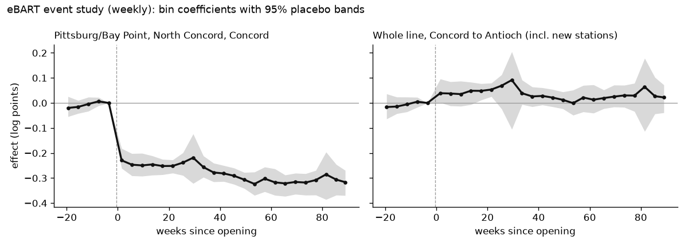
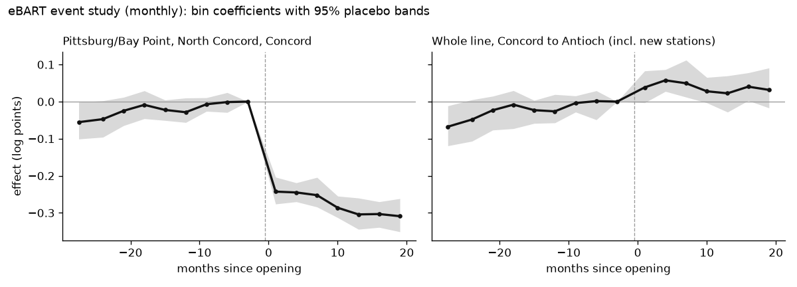

# Findings: did eBART bring new riders, or just move them?

A pre-registered difference-in-differences study of the eBART extension to Pittsburg Center and Antioch, which
opened on Saturday 26 May 2018. Every number on this page comes from `api/data/findings.json`, written by
`python -m analysis.causal.run` from the committed data in `analysis/causal/data/`. The site's Findings band and
`GET /api/findings` serve the same file. Data provided by BART: the inputs are BART's public origin-destination
ridership data and monthly ridership reports (see `analysis/causal/data/README.md`).

**Short answer.** Under the pre-registered rule the verdict is **new**. The whole line from Concord to Antioch
(including the two new stations) gained **+4.2%** weekly entries against 34 control stations (95% placebo interval
**+1.6% to +7.1%**), about 500 more entries a day. The three old stations together lost **-23.9%** (95% placebo
interval **-25.8% to -21.8%**), so most of the new stations' riders came from them. The pre-registered caution flag
is off. Read §Interpretation and §Limitations before quoting the +4.2%: the gain fades after the first year, and the
longer monthly series shows the corridor already rising against the controls in 2016–2017.

## Question
Did the eBART extension to Pittsburg Center (PCTR) and Antioch (ANTC) change ridership at the nearby legacy
stations, Pittsburg/Bay Point (PITT), North Concord (NCON) and Concord (CONC)? And did it bring new riders to the
corridor, or only move existing riders from the old stations to the new ones?

The corridor is the unit that separates the two. A rider who used to drive to PITT and now boards at ANTC leaves the
corridor total unchanged ("moved"). A rider new to BART raises it ("new").

## Pre-registration
The design was fixed before any treated-vs-control number was computed, and both files are committed and pushed
unchanged.

| file | fixed on | sha256 | commit |
|---|---|---|---|
| `analysis/causal/preregistration.json` | 2026-10-09 | `a05df98504818ffd4ea5fb69c720cea37eff76dd55859941acc3ce23d56e40f4` | `4c80c9b` |
| `analysis/causal/preregistration-amendment-1.json` | 2026-10-10 | `96395c97868f556d756415bef915f4fde13d971b5fb7b7cdb95505f876f36061` | `39b1a70` |

**Seen before fixing the original:** the first date with any entries per station (ANTC 2018-03-23 and PCTR
2018-04-17 test trickles; MLPT/BERY test trips from 2019-07), daily ANTC+PCTR entries for 2018-05-20..28 only (to
confirm the opening date: single digits, then 918 on 2018-05-26), the missing dates in the window (2020-01-21,
2020-02-19), and that BART publishes daily OD files only from 2018.

**Amendment 1** was fixed after the synthetic validation and **before any real-data estimate was computed or
viewed**. The original corridor inference drew placebo corridors of 5 control stations. Before the opening, however,
the real corridor is effectively the 3 legacy stations, because ANTC and PCTR are 0. A sum of 5 stations is
smoother than a sum of 3, so the placebo distribution was too narrow. On synthetic data the corridor's placebo
interval covered only 0.84 under the null, below the pre-registered 0.90 bar.

The amendment makes the corridor placebos **all C(34,3) = 5,984 sets of 3 controls, each summed into one unit**.
Nothing else changed: sets, windows, bins, outcomes, the seed, the verdict rule and the caution rule are all as in
the original. `analysis/causal/design.py` applies the amendment on load: it checks that `amends_sha256` matches the
original and that every changed value equals its `was`.

The synthetic coverage study, run unchanged (`python -m analysis.causal.synthetic --sims 200 --seed 0`, same DGP:
σ = 0.04, ρ = 0.5), before and after the amendment:

| scenario | estimand | placebo coverage, original | placebo coverage, amended | CR1 coverage |
|---|---|---|---|---|
| null | legacy | 0.935 | 0.935 | 0.79 |
| null | corridor | **0.84** | **0.925** | — |
| moved | legacy | 0.965 | 0.965 | 1.00 |
| moved | corridor | 0.91 | 0.96 | — |
| new | legacy | 0.95 | 0.95 | 0.825 |
| new | corridor | **0.87** | **0.935** | — |

Randomization-inference rejection at 5% under the null: legacy 0.065 → 0.065 and corridor **0.175 → 0.075**.
Bias is at most 0.002 log points and RMSE about 0.01. Verdicts under the amended design:

- "new" scenario: new 200/200.
- "moved" scenario: moved 192/200.
- null scenario: inconclusive 183/200.

The run was single and final. `run.py` was first exercised on a scrambled copy of the inputs (random values in the
real CSV shape), then run once on the real data. The committed output is that run.

## Data
- **Weekly (primary): BART daily origin-destination files** (`afcweb.bart.gov`), via the local warehouse
  (`marts.fct_station_daily`).
  - Summed to station × ISO week in `analysis/causal/data/station_week.csv` (5,412 rows, 50 stations, weeks
    2018-01-01 → 2020-02-17).
  - **Daily files exist only from 2018**: the 2015–2017 URLs return 404 and the Wayback Machine has no copy. So the
    weekly pre-period is 20 weeks.
  - The two weeks containing system-wide missing days (2020-01-21, 2020-02-19) are dropped. That leaves 109 weeks:
    20 pre and 89 post, through 2020-02-16, before COVID-19.
- **Monthly (robustness): BART monthly ridership workbooks** (`ridership_2016.zip` … `ridership_2020.zip`, sheet
  "Weekday OD").
  - Average-weekday entries per station, 2016-01 → 2020-02, in `analysis/causal/data/station_month_weekday.csv`.
  - Codes are mapped by `station_codes_2letter.csv`.
  - Every column sum matched the sheet's "Entries" total within 1.
- **Cross-check** of monthly against daily (non-holiday Monday–Friday means, 25 months, 48 stations):
  - The median |% difference| over controls + treated is **0.78%**.
  - The worst control/treated station median is 3.30% (19TH).
  - The worst corridor station is 3.54% (ANTC).
  - None is over 10%, so the monthly series is comparable.

## Design
- **Event:** revenue service began on Sat 2018-05-26. The transition ISO week (21–27 May, e = −1) is dropped, and
  week 0 starts on Mon 2018-05-28. For the monthly series, May 2018 is dropped and month 0 is June 2018.
- **Treated legacy stations:** PITT (the old terminus and the eBART transfer), and NCON and CONC (the next stations
  west, where East County drivers also parked).
- **New stations:** ANTC and PCTR. They have no pre-period, so they never stand as units on their own.
- **Corridor:** ANTC + PCTR + PITT + NCON + CONC, summed into one unit before the log.
- **Buffer (spillover check):** ORIN, LAFY, WCRK and PHIL, the rest of the Contra Costa yellow line.
- **Excluded stations:**
  - WARM and FRMT (Warm Springs opened in 2017 and was ramping up).
  - SFIA and OAKL (airport seasonality).
  - COLS (the Warriors moved in 2019).
  - MLPT and BERY (not open).
- **Controls:** the other 34 legacy stations, far from the Antioch line. A secondary set has 16 suburban
  park-and-ride controls.
- **Outcome:** ln(weekly entries). Exits are a robustness check.
- **Model:** two-way fixed effects, y = station FE + week FE + b·D, with D = treated × post (statsmodels OLS).
  Every reported b equals the exact double difference of station × week means (asserted to 1e-8).
- **Event study:** 4-week bins (monthly: 3-month bins), with reference bin e ∈ [−5, −2] (monthly [−4, −2]).
- **Inference.**
  - The headline 95% interval is a placebo (Conley–Taber style) interval, together with randomization-inference
    (RI) p-values. Both reassign treatment to control stations only:
    - legacy: all 5,984 sets of 3;
    - corridor: all 5,984 summed sets of 3 (Amendment 1);
    - buffer: 10,000 random sets of 4, seed 20180526;
    - per station: all 34 single controls.
  - CR1 cluster-robust intervals by station are reported, but they are not the headline: with 1–4 treated clusters
    they are unreliable (synthetic coverage 0.79–0.83).
- **Verdict rule (fixed):**
  - **new** if the corridor interval is above 0;
  - **moved** if it contains 0 and the legacy interval is below 0;
  - **fewer** if the corridor interval is below 0;
  - otherwise **inconclusive**.
- **Caution flag:** set if either weekly pre-trend RI p < 0.10, or if the monthly corridor interval excludes 0 with
  the opposite sign.

## Assumptions
- **Parallel trends:** without eBART, the treated stations' log entries would have moved like the controls'. The
  weekly pre-bins are within ±2% of the reference, but they are not flat: they rise about 2 points over the 16 pre
  weeks (legacy -2.0% → 0, corridor -1.6% → 0), the same direction as the monthly drift, and the legacy CR1 Wald
  pre-trend test gives p = 0.027 (see §Event study). The monthly pre-period is less reassuring still (see
  §Limitations).
- **No spillover to controls:** the controls are far from the line, and the buffer stations, the nearest
  non-treated ones, show no effect (+0.5%).
- **No anticipation:** the transition week is dropped. ANTC and PCTR had only test trickles before the opening.
- **Stable composition:** the same stations and the same OD definitions throughout. ML and BE columns appear in the
  2018 monthly workbooks as zeros.
- **How the OD data records eBART riders:** the transfer at Pittsburg/Bay Point is not recorded as an exit and a new
  entry. From 2018-05-28 to 2020-02-16, only **1.09%** of trips entering at ANTC/PCTR (22,338 of 2,049,800) ended at
  PITT. The rest are recorded through to their final station. So the corridor sum does not count a transfer twice.
  This is checked by `tests/local/test_causal_local.py`.

## Results
Primary weekly estimates (109 weeks, 34 controls). b is in log points and % = 100 × (e^b − 1).

| estimand | b | % | placebo 95% CI | CR1 95% CI (%) | RI p | draws |
|---|---|---|---|---|---|---|
| **Corridor** (1 unit) | 0.0415 | **+4.2%** | **+1.6% to +7.1%** | — | 0.0007 | 5,984 |
| **Legacy** (PITT, NCON, CONC pooled) | -0.2730 | **-23.9%** | **-25.8% to -21.8%** | -39.6% to -4.1% | 0.0002 | 5,984 |
| Buffer (ORIN, LAFY, WCRK, PHIL) | 0.0050 | +0.5% | -1.7% to +3.0% | -2.3% to +3.4% | 0.69 | 10,000 |
| PITT | -0.5126 | -40.1% | -42.0% to -37.4% | -40.6% to -39.6% | 0.029 | 34 |
| NCON | -0.2621 | -23.1% | -25.5% to -19.6% | -23.7% to -22.4% | 0.029 | 34 |
| CONC | -0.0443 | -4.3% | -7.4% to -0.0% | -5.1% to -3.6% | 0.086 | 34 |

- **Implied extra corridor entries:** about **505 a day** (95% interval **199 to 824**). This is the post-period
  mean weekly corridor entries × (1 − e^−b) / 7, averaged over all days of the week.
- **Per-station p-values:** with 34 single-station placebos, the smallest possible RI p is 1/35 = 0.029, and the
  per-station intervals are coarse. PITT and NCON reach that floor. CONC's interval only just excludes 0.

## Event study


- **Legacy.** The weekly pre-bins are within ±2% of the reference. The drop is immediate: -20.5% in weeks 0–3. It
  then deepens slowly, to about -27% after a year.
- **Corridor.**
  - About +4% to +5.5% in the first half-year, and +9.6% in weeks 28–31 (December/January, a wide band).
  - Then +1% to +3% from week 36 on.
  - Only 3 of the 23 post bins have a placebo band that excludes 0.
- **Pre-trend tests (weekly):**
  - RI p of the sum of squared pre-bin coefficients: legacy 0.43, corridor 0.66.
  - The legacy CR1 joint Wald test gives p = 0.027. It is reported as pre-registered, but CR1 over-rejects with 3
    treated clusters, which is why the RI test is the one in the caution rule.



- **Monthly series (2016-01 → 2020-02).** Both the legacy and the corridor series rise against the controls through
  the pre-period, from about -5% to -6.5% in early 2016 to 0 at the reference bin in spring 2018.
- **Monthly pre-trend RI p:** legacy 0.069, corridor 0.11. These are not part of the pre-registered caution rule.

## Robustness and falsification
| analysis | corridor % (placebo 95% CI) | legacy % (placebo 95% CI) | buffer % (placebo 95% CI) |
|---|---|---|---|
| Primary (weekly entries) | +4.2% (+1.6% to +7.1%) | -23.9% (-25.8% to -21.8%) | +0.5% (-1.7% to +3.0%) |
| Exits instead of entries | +3.8% (+0.7% to +7.2%) | -24.1% (-26.1% to -21.6%) | +0.6% (-1.9% to +3.4%) |
| 16 suburban controls | +3.8% (+1.1% to +7.3%) | -24.2% (-26.2% to -22.0%) | +0.1% (-2.3% to +2.7%) |
| Monthly avg weekday, 2016–2020 | +6.4% (+2.2% to +12.3%) | -22.5% (-25.4% to -18.9%) | +1.1% (-2.3% to +5.1%) |
| In-time placebo (fake opening 2018-03-12, pre weeks only) | +1.2% (-1.0% to +2.8%) | +1.4% (-0.6% to +3.1%) | +0.3% (-1.5% to +1.8%) |

- **Placebo sets.** The corridor's placebo sets are sets of 3 controls in every row (Amendment 1); with the 16
  suburban controls that is all 560 sets of 3. Legacy uses sets of 3, buffer sets of 4.
- **In-space placebo.** The real corridor estimate is more extreme than all but 3 of the 5,984 placebo corridors
  (RI p = 0.0007), and the legacy estimate is more extreme than every placebo set.
- **Agreement.** Every robustness row (exits, suburban controls, monthly) agrees in sign with the primary estimate,
  and each of their corridor intervals excludes 0.
- **In-time placebo.** This is a falsification test, not a robustness row: it finds nothing at the fake date, and its
  intervals correctly contain 0.

## Interpretation
- **Verdict: new** under the pre-registered rule. The corridor's weekly placebo interval (+1.6% to +7.1%) lies
  above 0. The legacy interval (-25.8% to -21.8%) lies below 0.
- **Caution flag: off.** Both weekly pre-trend RI p-values are ≥ 0.10 (0.43 and 0.66), and the monthly corridor
  interval (+2.2% to +12.3%) has the same sign as the weekly estimate.
- **Plain reading:**
  - eBART mostly **moved** riders. The three old stations lost about a quarter of their entries, and PITT about 40%.
    Most of those riders now board at Antioch or Pittsburg Center.
  - On top of that, the line as a whole gained a **small** number of riders, about +4% or roughly 500 entries a day,
    which by the rule counts as "new".
  - That net gain is largest in the first months and shrinks to +1% to +3% (not distinguishable from 0 bin by bin)
    from the second half of the first year.
  - There is no sign of spillover to the rest of the yellow line.

## Limitations
- **Few treated units.** There are 3 legacy stations and 1 corridor unit. Placebo/RI inference is exact only under
  its exchangeability assumption, and the per-station intervals rest on 34 placebos.
- **Short daily pre-period.** The weekly analysis has 20 pre weeks; the daily files do not go further back.
- **COVID cut-off.** The window ends in February 2020, 21 months after the opening, before COVID-19. Nothing here
  says what the effect was after that, so the long-run effect is unknown.
- **A pre-existing upward drift in the monthly data.** Against the controls, the corridor rose about 6.5% from early
  2016 to spring 2018 (monthly pre-trend RI p 0.11; legacy 0.069).
  - If that drift had continued after the opening, it alone could account for much of the +4.2%.
  - The pre-registered caution rule doesn't test the monthly pre-trend, so the flag is off. The trend-adjusted
    estimate was not pre-registered and is not computed here.
  - Treat "new riders" as **a small effect that may partly be trend**, not as a firm finding.
- **The monthly data are average weekdays only**, so they miss weekend ridership. They come from BART's published
  average-weekday OD workbooks, not the daily files. They agree with the daily files to a 0.78% median (§Data), but
  which days count as weekdays and holidays is BART's own definition.
- **Antioch parking.** Antioch has 1,012 spaces and was overfull, which caps how many drivers could switch to it.
- **Return trips contaminate the controls (SUTVA, spillover).** A new corridor rider's return trip is an entry at
  the destination, mostly an SF/Oakland control station. That raises the controls slightly and biases b towards 0.
  The order of magnitude is small: about 500 extra entries a day against the 34 controls' mean of about 276,000 a day
  over the post weeks (about 8,100 per station), roughly 0.2%. This is a descriptive figure from the committed
  `station_week.csv`, not an estimate.
- **Corridor inference rests on Amendment 1's "wide side" argument.** Amendment 1 compares the corridor with sums of
  3 controls on the grounds that this errs on the wide side. That holds only if the post-period 5-station corridor
  sum is no noisier than a 3-station sum. New-station ramp-up and parking saturation at Antioch can break that. The
  synthetic DGP (homogeneous AR(1), σ = 0.04) validates the method, not the real noise structure.
- **Bundled treatment.** Tri Delta Transit bus changes made at the opening are part of the treatment.
- **Other events in the window:**
  - The Salesforce Transit Center opened in August 2018, affecting the controls.
  - Line-specific service disruptions are not modelled.
  - BART ridership fell system-wide through 2019. The week fixed effects absorb a common decline, but not one that
    differs by line.
- **CR1 is reported but unreliable here.** On the synthetic data it covered 0.79–0.83, and its legacy Wald pre-trend
  test (p = 0.027) is reported for completeness.

## Reproduce
```sh
# rebuild the inputs (optional: the CSVs are committed)
uv run --group ml python -m analysis.causal.panel             # station_week.csv from data/transitpulse.duckdb
uv run --group ml python -m analysis.causal.monthly           # station_month_weekday.csv (downloads 5 zips)
uv run --group ml python -m analysis.causal.monthly --crosscheck --json

# validate the design, then the study
uv run --group ml python -m analysis.causal.synthetic --sims 200 --seed 0 --json
uv run python tasks.py causal                                  # findings.json + docs/img/*.png
uv run --group ml python -m analysis.causal.run --check       # byte-identical recomputation
uv run --group ml python -m analysis.causal.run --summary     # headline numbers
```
